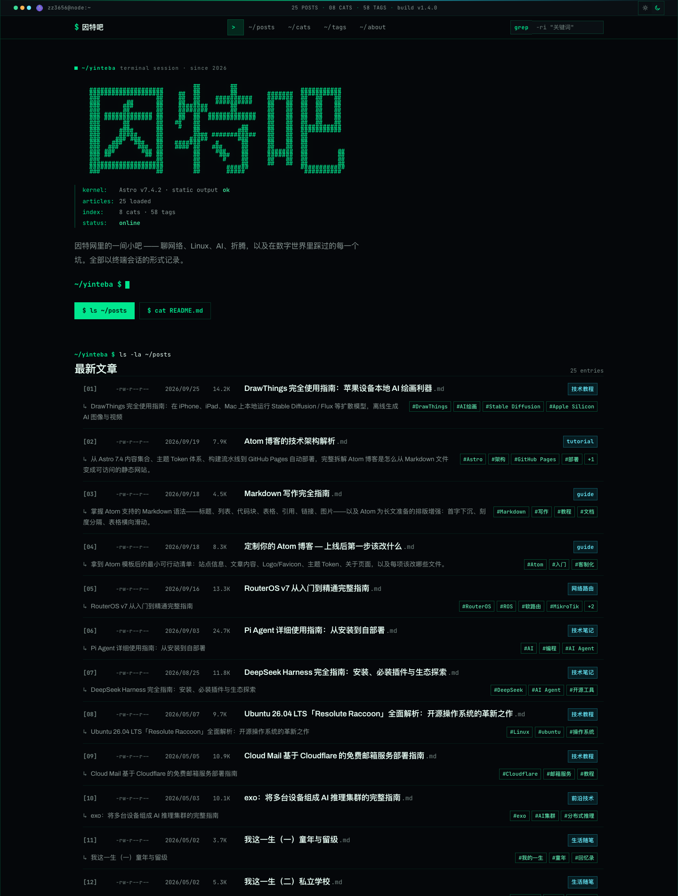
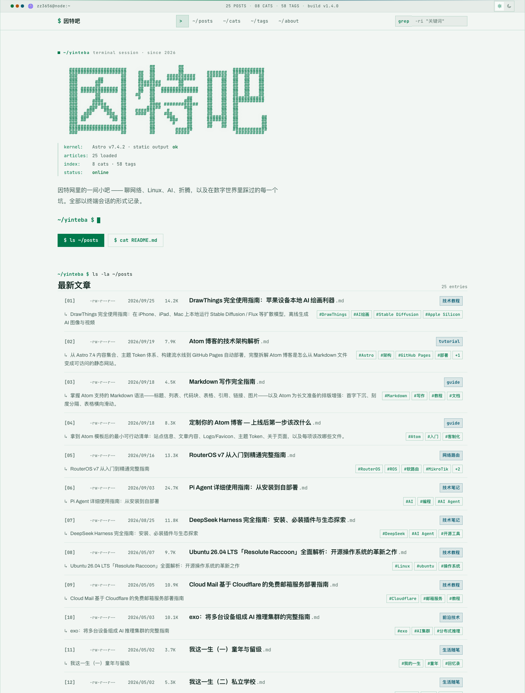
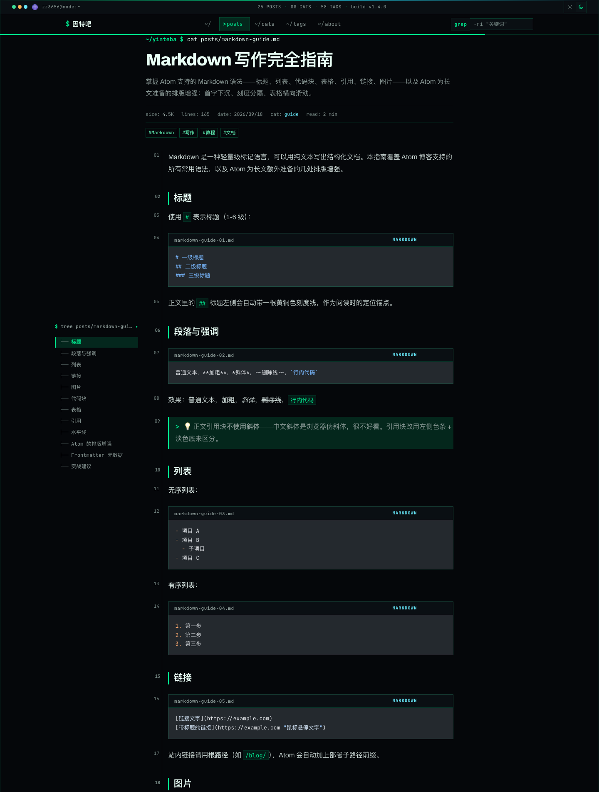
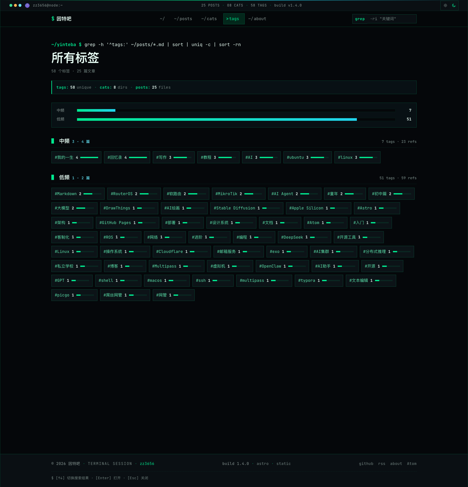
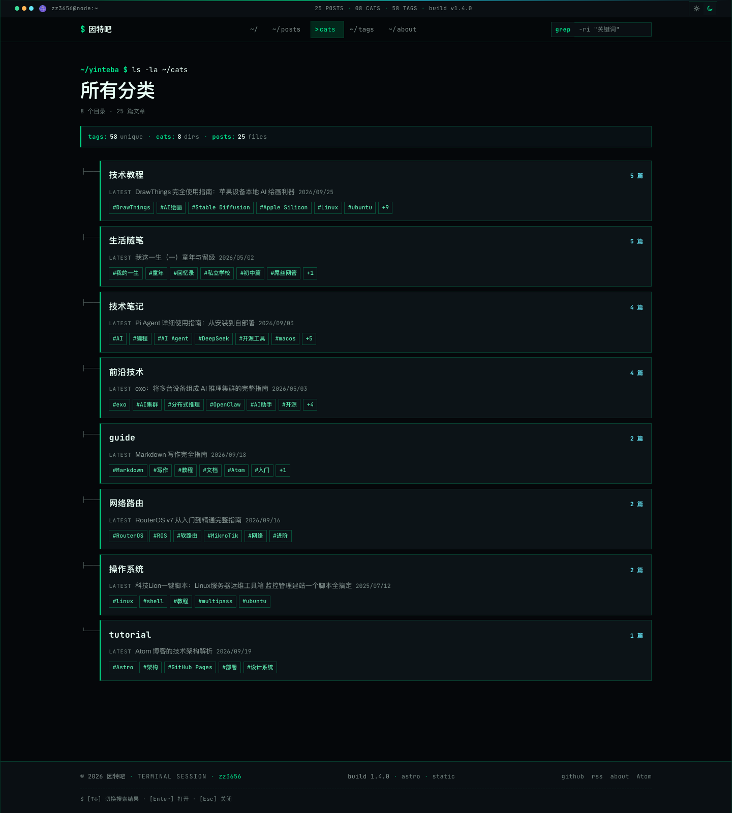
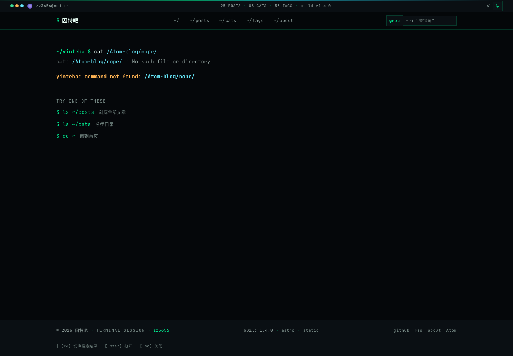
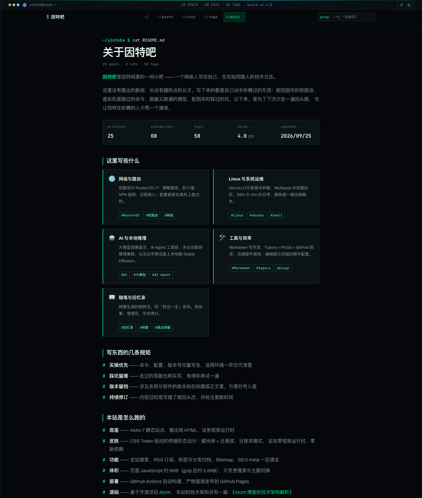
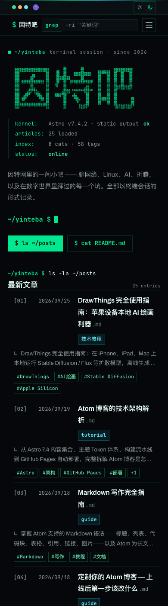
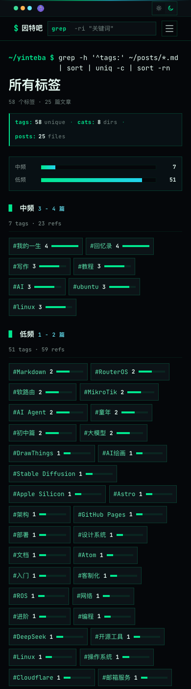

# Atom Geek —— TUI 终端形态主题包

> Atom 博客的**第三方主题**。把站点变成一台终端机：磷光绿/磷光纸双模配色，外加一套完整的 TUI 组件层覆盖包。
>
> 来源：[因特吧](https://zz3656.github.io/Atom-blog/)（zz3656 的 Atom 博客实例）· MIT License · 作者 zz3656

---

## 演示

| 首页 · 暗色（磷光终端） | 首页 · 亮色（磷光纸） |
|---|---|
|  |  |

| 文章页 · `cat` 输出 + 行号槽 | 标签页 · 词频面板 |
|---|---|
|  |  |

| 分类页 · 目录树面板 | 404 · command not found |
|---|---|
|  |  |

| About | 移动端 · 首页 | 移动端 · 标签页 |
|---|---|---|
|  |  |  |

---

## ⚠️ 先读这一段：两条安装路径

Atom 的主题契约规定**主题目录只能放 CSS token**。因此本仓库分成两个互不等价的部分：

| | `atom-geek/`（主题包） | `overlay/`（组件层覆盖包） |
|---|---|---|
| 装上后得到什么 | **只有配色**（磷光绿 / 磷光纸双模） | **完整 TUI 版式**（终端窗口、ls -la 列表、cat 文章页、grep 搜索、command not found 404…） |
| 契约位置 | `src/themes/atom-geek/` | 覆盖站点的 `src/components/` `src/layouts/` `src/pages/` `src/styles/` `src/scripts/` |
| Atom 官方支持 | ✅ 主题包是官方机制，零配置自动注册 | ⚠️ 非官方机制：直接替换组件层文件 |
| 能否独立生效 | ✅ 可以，复制过去就完事 | ❌ 不能，必须先装主题包 |

**结论：只复制 `atom-geek/` 目录，你拿到的是一套很好看的配色，但不是 TUI。**
完整的终端形态必须叠加 `overlay/` 的组件层重写。

### 路径 A｜只要配色（主题包，零配置）

```bash
# 1. 复制主题包到你的 Atom 站点
cp -r atom-geek/ /path/to/your-atom-blog/src/themes/

# 2. 构建时 theme-loader 会自动扫描 src/themes/ 并注册
cd /path/to/your-atom-blog && npm run dev
```

然后在站点的 `src/consts.ts` 里把它设为默认主题：

```ts
export const DEFAULT_THEME_ID = 'atom-geek';
```

零配置项需要额外改动：主题目录名必须与 `manifest.json` 的 `id` 一致。

### 路径 B｜完整 TUI（主题包 + 组件层覆盖）

先执行路径 A，再按 [`overlay/README.md`](./overlay/README.md) 应用组件层覆盖。

```bash
# 假设你的站点在 ~/blog，本仓库在 ~/atom-geek
cp -r ~/atom-geek/atom-geek ~/blog/src/themes/

# 按 overlay/README.md 的「文件对照表」覆盖组件层
# 涉及 components / layouts / pages / styles / scripts 五个目录
```

**回退**：所有 overlay 文件都有上游对应物，回退即恢复原文件（见 overlay/README.md 的「回退方式」一节）。

---

## 能力边界

### 主题包能做什么

- 完整的明暗双模配色（43 个必需 token + 2 个可选 token）
- 磷光终端（暗色）/ 磷光纸（亮色）两套视觉基调
- 零圆角硬边、辉光代替投影、网格底纹、刻度尺配色
- 搜索命中高亮、焦点环、标签/分类双语义通道

### 主题包不能做什么

- **不能改版式**。Atom 的主题契约禁止主题覆盖布局 token（`--radius*` / `--font-*` / `--max-width` / `--content-width` / `--header-height` / `--rule-*` / `--log-gutter`），也禁止在主题里写组件样式。
- **不能加 JS**。主题目录只允许 CSS token。
- **不能改 HTML 结构**。

### overlay 能做什么

- 终端窗口外壳、两行 Header（status bar）
- Hero 终端启动序列、ASCII 装饰
- `ls -la` 形态的文章列表、词频面板、目录树面板
- `cat` 形态文章页 + 行号槽（gutter）
- 终端标题栏代码块、`grep` 式搜索结果、command not found 404

### 为什么分成两包（换皮 vs 客制化）

这是本仓库最重要的设计决定，理由有三：

1. **契约边界**：`docs/THEMING.md` 是全站公共契约，也是第三方主题的准入依据。主题包一旦写组件样式，第三方主题就无法在本站共存——破坏的是站点生态，不是这一套主题。
2. **能力天花板**：直角化、等宽字体角色重分配、CRT 质感、终端标题栏，这些在 token 体系里**不可表达**——它们是「用哪个字体变量」「border-radius 取什么值」的选择器级决策。只有重写组件层才能拿到。
3. **回退成本最低**：token 归主题包（可复用、可分发），选择器级差异归 overlay（可整份删除、零残留）。删掉 overlay 不会让站点崩，只会退回普通版式。

---

## token 契约摘要

完整契约见上游：<https://github.com/zz3656/Atom/blob/main/docs/THEMING.md>

### 必需 token 分类与数量（共 43 必需 + 2 可选 = 45）

| 类别 | 数量 | Token |
|---|---|---|
| 背景 | 5 | `--bg-primary` `--bg-secondary` `--bg-card` `--bg-card-hover` `--bg-inline-code` |
| 文本 | 4 | `--text-primary` `--text-secondary` `--text-muted` `--text-bright` |
| 边框 | 3 | `--border-color` `--border-light` `--border-glow` |
| 主色 | 5 | `--accent` `--accent-hover` `--accent-secondary` `--accent-gradient` `--accent-glow` |
| 标签 | 4 | `--tag-bg` `--tag-text` `--tag-border` `--tag-active-bg` |
| 分类 | 4 | `--cat-bg` `--cat-text` `--cat-border` `--cat-active-bg` |
| 语义色 | 2 | `--success` `--warning` |
| 阴影 | 5 | `--shadow-sm` `--shadow` `--shadow-md` `--shadow-lg` `--shadow-glow` |
| v3 语义表面 | 11 | `--on-accent` `--header-bg` `--panel-bg` `--code-bg` `--grid-line` `--highlight` `--ambient-glow` `--rule-tick` `--rule-tick-strong` `--focus-ring` `--glow-secondary` |
| 可选 | 2 | `--accent-glow-strong` `--purple-glow`（旧别名，保留兼容） |

### 选择器写法

```css
/* light.css */
html[data-theme='atom-geek'][data-mode='light'] { /* ... */ }

/* dark.css */
html[data-theme='atom-geek'][data-mode='dark'] { /* ... */ }
```

单模式主题用 `html[data-theme='atom-geek']`（不带 `data-mode`）。

### 硬性红线

- ❌ 禁止覆盖布局 token：`--font-display` `--font-sans` `--font-mono` `--radius` `--radius-lg` `--radius-sm` `--max-width` `--content-width` `--header-height` `--rule-height` `--rule-major` `--rule-minor` `--log-gutter`
- ❌ 禁止 `!important`
- ❌ 主题里不写组件样式
- ❌ 主题里不写 JS / HTML
- ✅ 目录名必须与 `manifest.json` 的 `id` 一致，`id` 匹配 `^[a-z0-9][a-z0-9_-]{0,31}$`

---

## 兼容性

| 项 | 要求 |
|---|---|
| Astro | 7.x |
| Atom | v3（需支持 v3 语义表面 token） |
| 运行时 | 零框架运行时、零新依赖、不新增字体请求 |
| 模式 | 明暗双模（`modes: ["light", "dark"]`） |
| 浏览器 | 现代浏览器（CSS 变量 + `:focus-visible` + `prefers-reduced-motion`）；不承诺 IE11 |

### WCAG 2.1 AA 实测对比度

正文文本类 token 对 `bg-primary` / `bg-card` 实测比值（sRGB 相对亮度，alpha 按 source-over 合成后计算）：

| 模式 | 实测区间 | 判定 |
|---|---|---|
| 暗色（磷光终端） | **5.26 – 13.91 : 1** | 全部 ≥ 4.5 ✅ |
| 亮色（磷光纸） | **4.60 – 12.92 : 1** | 全部 ≥ 4.5 ✅ |

关键采样点：暗色 `--text-primary` 13.22、`--accent` 12.43、`--cat-text` 13.91；亮色 `--text-primary` 12.92、`--accent` 5.01、`--text-muted` 4.75、`--warning` 4.60。
`--focus-ring` 作为非文本焦点指示按 ≥ 3:1 判定：暗色 12.43、亮色 5.01。

> 亮色主色为满足 AA 从鲜亮的 `#00a86b`（2.83:1）降饱和为 `#00794c`（5.01:1）——因为 `--accent` 是正文链接色，小字号文本需要 4.5:1。暗色主形态保留鲜亮磷光绿 `#00e88f`（12.43:1）。

---

## 设计理念

### TUI 终端语义

整个站点复用一套命令行隐喻，而不是把「绿字黑屏」当贴图：

| 终端概念 | 站点对应 |
|---|---|
| `status bar` | 顶部两行 Header：站名 / 路径 / 状态指示点 |
| 启动序列 | 首页 Hero 的终端启动输出 + ASCII 装饰 |
| `ls -la` | 文章列表：序号、权限位式排布、日期、文件名式标题 |
| `cat` | 文章页：正文按行输出，左侧行号槽（gutter） |
| `grep` | 搜索结果高亮命中词（`GrepHit`） |
| 目录树 | 标签页 / 分类页的词频面板与目录树面板 |
| `command not found` | 404 页 |
| 终端标题栏 | 代码块的窗口栏与复制按钮 |

### 磷光终端 / 磷光纸双模

- **暗色 = 主形态**：近黑蓝底 `#05070a` + 磷光绿 `#00e88f`，像一台老式终端机，状态点常亮。
- **亮色 = 磷光纸**：浅纸面 `#f2f6f3` + 深磷光绿墨水 `#00794c`，像一张泛着绿意的工程绘图纸，长时间阅读不刺眼。
- 副色通道统一为青色系（暗色 `#22d3ee` / 亮色 `#0a5c72`），**只用于分类**这一个语义通道，避免多色打架。

### 零圆角 · 辉光代替投影

终端没有圆角。所有圆角归零，层次靠 1px 硬边框 + 辉光（`--shadow-glow` / `--accent-glow`）而不是柔和投影制造。

### 等宽字体只管真实数据

JetBrains Mono 只用于**真实的数据与机器输出**：日期、计数、序号、路径、状态、快捷键、命令。正文与标题保持无衬线（Archivo + 中文无衬线）——中文长文用等宽会显著降低阅读体验。

---

## 来源与许可

主题取自 [因特吧](https://zz3656.github.io/Atom-blog/)（`zz3656/Atom-blog` 的 TUI 形态实例），由 zz3656 原创。

- 代码与主题：MIT License，见 [LICENSE](./LICENSE)
- 完整 token 契约与架构说明：[`docs/ARCHITECTURE-ATOM-GEEK.md`](./docs/ARCHITECTURE-ATOM-GEEK.md)
- TUI 重做设计说明：[`docs/TUI-REDESIGN.md`](./docs/TUI-REDESIGN.md)
- 上游主题开发指南：<https://github.com/zz3656/Atom/blob/main/docs/THEMING.md>

## 相关仓库

| 仓库 | 内容 |
|---|---|
| [zz3656/Atom](https://github.com/zz3656/Atom) | Atom 博客主仓（含官方 `atom-default` 主题与主题开发指南） |
| [zz3656/atom-geek](https://github.com/zz3656/atom-geek) | **本仓库**：TUI 终端形态主题包 + overlay 覆盖包 |
| [zz3656/atom-themes](https://github.com/zz3656/atom-themes) | 其它第三方主题（sepia / solarized） |
